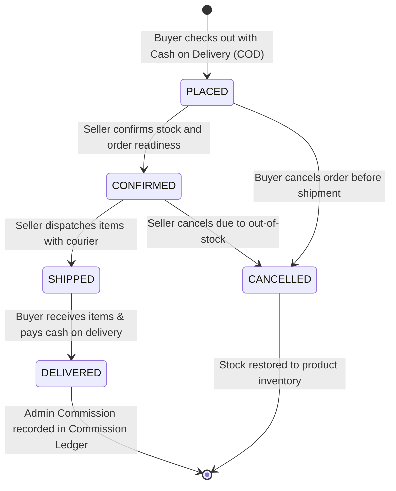

# Baghbaan AI — Application Flow & User Journeys

This document defines the user interaction flows, state machines, and system event sequences for Baghbaan AI across web and mobile clients.

---

## 1. High-Level Site & App Navigation Map

```mermaid
graph TD
    Landing["Landing / Welcome Screen<br/>(Urdu / English Toggle)"] --> Auth["Auth Portal (Login / Register)"]
    
    Auth --> Dashboard["Main Dashboard / Home"]
    
    Dashboard --> AI["AI Plant Doctor"]
    AI --> AIDiagnosis["Upload Leaf Photo & Instant Diagnosis"]
    AI --> AIChatbot["Urdu Voice/Text Gardening Chatbot"]
    AI --> AIHistory["Diagnosis History & Escalation"]

    Dashboard --> Care["Smart Care & Garden Hub"]
    Care --> MyPlants["My Plants Inventory & Digital Beds"]
    Care --> CareCalendar["Weather-Adjusted Care Calendar"]
    Care --> PlantTimeline["Health Timeline & Photo Log"]
    Care --> PlantEncyclopedia["Pakistani Plant Encyclopedia"]

    Dashboard --> Services["Garden Services (Proximity Based)"]
    Services --> GardenerDirectory["Verified Gardener / Supervisor Search"]
    Services --> GardenManagement["Garden Creation & Budgets"]
    Services --> TaskLifecycle["5-State Task Management"]
    Services --> GardenReports["Gardener Progress Reports & Expenses"]

    Dashboard --> Market["Marketplace-Lite (Cash On Delivery)"]
    Market --> ProductCatalog["Browse Approved Gardening Supplies"]
    Market --> ShoppingCart["Cart & Checkout (COD)"]
    Market --> OrderTracking["Order Lifecycle Tracking"]
    Market --> SellerPortal["Seller Dashboard (Apply / Manage Listings)"]

    Dashboard --> CommunityHub["Community & Real-Time Chat"]
    CommunityHub --> InterestGroups["Nearby & Interest-Based Groups"]
    CommunityHub --> LiveChatRooms["Direct / Garden / Community Rooms"]

    Dashboard --> UserProfile["User Profile & Language/City Settings"]
```



---

## 2. AI Plant Doctor Diagnosis Flow

```mermaid
sequenceDiagram
    autonumber
    actor User as Homeowner / Gardener
    participant UI as Web / Mobile UI
    participant Svc as AI Doctor Service
    participant Gemini as Google Gemini API
    participant PlantID as Plant.id API
    participant KB as Offline Knowledge Base
    participant DB as SQLite DB

    User->>UI: Captures/Uploads Leaf Photo (JPEG/PNG <= 5MB)
    UI->>Svc: POST /api/v1/diagnoses/ (image, language, city)
    Svc->>Svc: Preprocess: Validate MIME, size, compute hash
    
    alt Image Hash Cached Recently
        Svc->>DB: Fetch cached diagnosis
        Svc-->>UI: Return Cached Diagnosis Result
    else Fresh Diagnosis
        Svc->>Gemini: Validate image is a plant (Botanical Gatekeeper)
        alt Not a Plant
            Gemini-->>Svc: is_plant = false
            Svc-->>UI: 400 Bad Request: "Please upload a clear photo of a plant or leaf."
        else Is a Plant
            Gemini-->>Svc: is_plant = true
            
            par Query Vision Providers
                Svc->>PlantID: Identify species & detect pathology
                PlantID-->>Svc: Species, Disease Candidates & Probabilities
            and Query Gemini Vision
                Svc->>Gemini: Analyze symptoms & severity
                Gemini-->>Svc: Observations & Candidate Diseases
            end
            
            alt Primary Providers Succeeded
                Svc->>Gemini: Prompt treatment advice in selected language (Urdu/Roman/Eng)<br/>given species, disease, city & season
                Gemini-->>Svc: Structured Organic & Chemical Treatment Steps
                Svc->>Svc: Calculate Aggregate Confidence Score
            else Plant.id Unavailable
                Svc->>Gemini: Run Gemini-only diagnosis & advice (Lower Confidence)
                Gemini-->>Svc: Gemini Diagnosis Result
            else All External AI APIs Down
                Svc->>KB: Match user-selected symptoms & plant name
                KB-->>Svc: Curated Offline Treatment Guide
            end

            Svc->>DB: Save Diagnosis record (User, Image, Disease, Confidence, Advice)
            
            alt Confidence < 60% (Admin Threshold)
                Svc-->>UI: Return Diagnosis marked as UNCERTAIN + Escalation Prompt (Ask Mali / Forum)
            else High Confidence
                Svc-->>UI: Return Diagnosis Result with Treatment Guide & Safety Disclaimer
            end
        end
    end
```



---

## 3. Garden Services 5-State Task Lifecycle

The task management module strictly enforces a deterministic state machine:

```mermaid
stateDiagram-v2
    [*] --> CREATED: Homeowner or Supervisor creates task
    CREATED --> ASSIGNED: Assign task to a verified Gardener
    ASSIGNED --> IN_PROGRESS: Gardener starts work on site
    IN_PROGRESS --> SUBMITTED: Gardener submits report with photo evidence
    
    SUBMITTED --> APPROVED: Supervisor / Homeowner approves report
    SUBMITTED --> IN_PROGRESS: Supervisor rejects report (returns for revision)
    
    APPROVED --> [*]: Task marked Complete; Garden budget updated
```



### State Transition Validation Table

| Current State | Permitted Action | Next State | Authorized Roles | Preconditions & Validation |
|---|---|---|---|---|
| `CREATED` | Assign | `ASSIGNED` | Homeowner, Supervisor | Assigned gardener must be an active member of the garden. |
| `ASSIGNED` | Start Task | `IN_PROGRESS` | Assigned Gardener | Current user must match `task.assignee`. |
| `IN_PROGRESS` | Submit Report | `SUBMITTED` | Assigned Gardener | Must provide completion notes and at least 1 photo proof. |
| `SUBMITTED` | Approve | `APPROVED` | Homeowner, Supervisor | Validates work; marks garden milestone complete. |
| `SUBMITTED` | Reject / Return | `IN_PROGRESS` | Homeowner, Supervisor | Must supply revision comments explaining deficiencies. |

---

## 4. Marketplace-Lite & Order Lifecycle



---

## 5. Weather-Aware Care Calendar Synchronization Flow

```mermaid
sequenceDiagram
    autonumber
    participant Cron as 15-Minute Scheduled Worker
    participant Engine as Care & Weather Engine
    participant WeatherAPI as Open-Meteo REST API
    participant DB as SQLite DB
    participant Notifier as Push / Email / In-App Notifier

    Cron->>Engine: Run care schedule check
    Engine->>DB: Query UserPlants and active CareTasks
    Engine->>WeatherAPI: Fetch latest 48h forecast for each unique user city
    WeatherAPI-->>Engine: Temperature, Rain (mm), Humidity
    
    loop For each due task today
        alt Rain >= 5.0 mm forecast within 24 hours
            Engine->>DB: Postpone task due_date by 24h; add weather note "Rain expected"
        else Max Temp >= 38 C (Extreme Heat)
            Engine->>DB: Add hydration tip: "Water early morning or after sunset"
        else Min Temp <= 3 C (Frost alert)
            Engine->>DB: Add frost protection reminder: "Cover sensitive outdoor plants"
        end
    end

    Engine->>DB: Query tasks due for notification (not yet alerted)
    loop For each un-alerted due task
        Engine->>Notifier: Dispatch In-App Notice + Push Notification + Email
        Notifier->>DB: Mark reminder_sent = True, timestamp = now
    end
```
