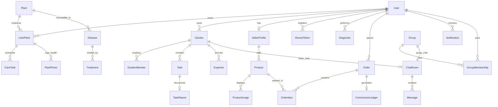

# Baghbaan AI — Backend Schema & Data Models

This document details the complete relational schema implemented across Django applications using the Django ORM on SQLite (with WAL mode).

---

## 1. Schema Entity Relationship Overview



---

## 2. Django Apps & Model Definitions

### App 1: `accounts`
Handles authentication, role management, seller verification, and mobile device tokens.

```python
# User Model (AbstractUser)
class User(AbstractUser):
    ROLE_CHOICES = (
        ('HOMEOWNER', 'Homeowner'),
        ('GARDENER', 'Gardener'),
        ('SUPERVISOR', 'Supervisor'),
        ('ADMIN', 'Admin'),
    )
    LANGUAGE_CHOICES = (
        ('ur', 'Urdu'),
        ('ur_ro', 'Roman Urdu'),
        ('en', 'English'),
    )
    role = models.CharField(max_length=20, choices=ROLE_CHOICES, default='HOMEOWNER', db_index=True)
    phone = models.CharField(max_length=20, blank=True, null=True, unique=True)
    city = models.CharField(max_length=100, default='Lahore', db_index=True)
    latitude = models.DecimalField(max_digits=9, decimal_places=6, null=True, blank=True)
    longitude = models.DecimalField(max_digits=9, decimal_places=6, null=True, blank=True)
    preferred_language = models.CharField(max_length=10, choices=LANGUAGE_CHOICES, default='ur')
    avatar = models.ImageField(upload_to='avatars/', null=True, blank=True)
    is_verified_professional = models.BooleanField(default=False)
    created_at = models.DateTimeField(auto_now_add=True)

# SellerProfile Model
class SellerProfile(models.Model):
    STATUS_CHOICES = (
        ('PENDING', 'Pending Admin Verification'),
        ('VERIFIED', 'Verified Seller'),
        ('REJECTED', 'Rejected'),
        ('SUSPENDED', 'Suspended'),
    )
    user = models.OneToOneField(User, on_delete=models.CASCADE, related_name='seller_profile')
    business_name = models.CharField(max_length=150)
    cnic_number = models.CharField(max_length=20, blank=True)
    shop_address = models.TextField()
    contact_phone = models.CharField(max_length=20)
    verification_status = models.CharField(max_length=20, choices=STATUS_CHOICES, default='PENDING', db_index=True)
    admin_notes = models.TextField(blank=True)
    created_at = models.DateTimeField(auto_now_add=True)

# DeviceToken Model
class DeviceToken(models.Model):
    user = models.ForeignKey(User, on_delete=models.CASCADE, related_name='device_tokens')
    token = models.CharField(max_length=255, unique=True)
    platform = models.CharField(max_length=20, default='android')
    updated_at = models.DateTimeField(auto_now=True)
```

---

### App 2: `plants`
Knowledge base of Pakistani botanical species, pathological diseases, and treatments.

```python
# Plant Model
class Plant(models.Model):
    name_en = models.CharField(max_length=100)
    name_ur = models.CharField(max_length=100)
    name_roman = models.CharField(max_length=100, blank=True)
    scientific_name = models.CharField(max_length=150, unique=True)
    category = models.CharField(max_length=50) # e.g. Ornamental, Fruit, Vegetable, Herb, Tree
    image = models.ImageField(upload_to='plants/', null=True, blank=True)
    description_en = models.TextField()
    description_ur = models.TextField()
    
    # Baseline Care Parameters
    watering_interval_days = models.PositiveIntegerField(default=2)
    fertilizer_interval_days = models.PositiveIntegerField(default=30)
    pruning_season = models.CharField(max_length=50, blank=True)
    sunlight_requirement = models.CharField(max_length=50, default='Full Sun')
    is_indoor_suitable = models.BooleanField(default=False)
    climate_notes_pakistan = models.TextField(blank=True)

# Disease Model
class Disease(models.Model):
    name_en = models.CharField(max_length=100)
    name_ur = models.CharField(max_length=100)
    name_roman = models.CharField(max_length=100, blank=True)
    scientific_name = models.CharField(max_length=150, blank=True)
    plants = models.ManyToManyField(Plant, related_name='diseases')
    symptoms_en = models.TextField()
    symptoms_ur = models.TextField()
    severity_level = models.CharField(max_length=20, default='Medium') # Low, Medium, High, Critical
    sample_image = models.ImageField(upload_to='diseases/', null=True, blank=True)

# Treatment Model
class Treatment(models.Model):
    TREATMENT_TYPES = (
        ('ORGANIC', 'Organic / Home Remedy'),
        ('CHEMICAL', 'Chemical / Commercial Fungicide or Pesticide'),
    )
    disease = models.ForeignKey(Disease, on_delete=models.CASCADE, related_name='treatments')
    treatment_type = models.CharField(max_length=20, choices=TREATMENT_TYPES, default='ORGANIC')
    title_en = models.CharField(max_length=150)
    title_ur = models.CharField(max_length=150)
    instructions_en = models.TextField()
    instructions_ur = models.TextField()
    safety_disclaimer_ur = models.TextField(blank=True)
```

---

### App 3: `ai_doctor`
Stores multimodal diagnosis sessions, AI configurations, and chatbot interactions.

```python
class AISetting(models.Model):
    provider_priority = models.CharField(max_length=100, default='PLANT_ID_THEN_GEMINI')
    confidence_threshold = models.FloatField(default=60.0) # Percentage
    daily_quota_limit = models.PositiveIntegerField(default=1000)
    is_active = models.BooleanField(default=True)
    updated_at = models.DateTimeField(auto_now=True)

class Diagnosis(models.Model):
    user = models.ForeignKey(User, on_delete=models.SET_NULL, null=True, blank=True, related_name='diagnoses')
    image = models.ImageField(upload_to='diagnoses/%Y/%m/')
    image_hash = models.CharField(max_length=64, db_index=True)
    detected_species = models.CharField(max_length=150, blank=True)
    detected_disease = models.CharField(max_length=150, blank=True)
    confidence = models.FloatField(default=0.0)
    is_confident = models.BooleanField(default=True)
    provider_used = models.CharField(max_length=50, default='GEMINI_VISION')
    advice_en = models.TextField(blank=True)
    advice_ur = models.TextField(blank=True)
    advice_roman = models.TextField(blank=True)
    is_escalated = models.BooleanField(default=False)
    created_at = models.DateTimeField(auto_now_add=True, db_index=True)

class ChatSession(models.Model):
    user = models.ForeignKey(User, on_delete=models.CASCADE, related_name='chat_sessions')
    session_title = models.CharField(max_length=150, default='Gardening Chat')
    created_at = models.DateTimeField(auto_now_add=True)

class ChatMessageAI(models.Model):
    session = models.ForeignKey(ChatSession, on_delete=models.CASCADE, related_name='messages')
    is_user = models.BooleanField(default=True)
    text = models.TextField()
    audio_file = models.FileField(upload_to='chat_audio/', null=True, blank=True)
    created_at = models.DateTimeField(auto_now_add=True)
```

---

### App 4: `care`
Personal garden inventory, weather-adjusted care calendars, and health timeline.

```python
class UserPlant(models.Model):
    user = models.ForeignKey(User, on_delete=models.CASCADE, related_name='user_plants')
    plant_template = models.ForeignKey('plants.Plant', on_delete=models.SET_NULL, null=True, blank=True)
    nickname = models.CharField(max_length=100)
    garden = models.ForeignKey('services.Garden', on_delete=models.SET_NULL, null=True, blank=True, related_name='plants')
    location_description = models.CharField(max_length=100, default='Balcony / Rooftop') # Courtyard, Lawn, Indoor
    is_indoor = models.BooleanField(default=False)
    primary_photo = models.ImageField(upload_to='user_plants/', null=True, blank=True)
    watering_interval_days = models.PositiveIntegerField(default=2)
    last_watered_date = models.DateField(null=True, blank=True)
    created_at = models.DateTimeField(auto_now_add=True)

class CareTask(models.Model):
    TASK_TYPES = (
        ('WATER', 'Watering 💧'),
        ('FERTILIZE', 'Fertilizing 🧪'),
        ('PRUNE', 'Pruning ✂️'),
        ('FROST_PROTECT', 'Frost Protection ❄️'),
    )
    STATUS_CHOICES = (
        ('PENDING', 'Pending'),
        ('COMPLETED', 'Completed'),
        ('SKIPPED', 'Skipped'),
        ('POSTPONED', 'Postponed for Weather'),
    )
    user_plant = models.ForeignKey(UserPlant, on_delete=models.CASCADE, related_name='care_tasks')
    task_type = models.CharField(max_length=20, choices=TASK_TYPES, default='WATER')
    scheduled_date = models.DateField(db_index=True)
    status = models.CharField(max_length=20, choices=STATUS_CHOICES, default='PENDING')
    weather_note = models.CharField(max_length=255, blank=True)
    completed_at = models.DateTimeField(null=True, blank=True)
    reminder_sent = models.BooleanField(default=False)

class PlantPhoto(models.Model):
    user_plant = models.ForeignKey(UserPlant, on_delete=models.CASCADE, related_name='health_photos')
    photo = models.ImageField(upload_to='plant_timeline/%Y/%m/')
    note = models.TextField(blank=True)
    taken_at = models.DateTimeField(auto_now_add=True)

class WeatherSnapshot(models.Model):
    city = models.CharField(max_length=100, db_index=True)
    temperature = models.FloatField()
    precipitation_mm = models.FloatField(default=0.0)
    forecast_24h_rain_mm = models.FloatField(default=0.0)
    weather_condition = models.CharField(max_length=100)
    fetched_at = models.DateTimeField(auto_now=True)
```

---

### App 5: `services`
Garden workspaces, team management, 5-state task lifecycle, and expense ledger.

```python
class Garden(models.Model):
    owner = models.ForeignKey(User, on_delete=models.CASCADE, related_name='gardens')
    name = models.CharField(max_length=150)
    location_address = models.TextField()
    city = models.CharField(max_length=100, default='Lahore')
    total_budget = models.DecimalField(max_digits=12, decimal_places=2, default=0.0)
    created_at = models.DateTimeField(auto_now_add=True)

class GardenMember(models.Model):
    MEMBER_ROLES = (
        ('GARDENER', 'Gardener / Mali'),
        ('SUPERVISOR', 'Supervisor'),
    )
    garden = models.ForeignKey(Garden, on_delete=models.CASCADE, related_name='members')
    user = models.ForeignKey(User, on_delete=models.CASCADE, related_name='garden_memberships')
    role = models.CharField(max_length=20, choices=MEMBER_ROLES, default='GARDENER')
    joined_at = models.DateTimeField(auto_now_add=True)

    class Meta:
        unique_together = ('garden', 'user')

class Task(models.Model):
    STATE_CHOICES = (
        ('CREATED', 'Created'),
        ('ASSIGNED', 'Assigned'),
        ('IN_PROGRESS', 'In Progress'),
        ('SUBMITTED', 'Submitted for Review'),
        ('APPROVED', 'Approved & Completed'),
    )
    garden = models.ForeignKey(Garden, on_delete=models.CASCADE, related_name='tasks')
    title = models.CharField(max_length=200)
    description = models.TextField()
    state = models.CharField(max_length=20, choices=STATE_CHOICES, default='CREATED', db_index=True)
    assigned_to = models.ForeignKey(User, on_delete=models.SET_NULL, null=True, blank=True, related_name='assigned_tasks')
    created_by = models.ForeignKey(User, on_delete=models.CASCADE, related_name='created_tasks')
    due_date = models.DateField(null=True, blank=True)
    created_at = models.DateTimeField(auto_now_add=True)
    updated_at = models.DateTimeField(auto_now=True)

class TaskReport(models.Model):
    task = models.OneToOneField(Task, on_delete=models.CASCADE, related_name='report')
    notes = models.TextField()
    photo_proof = models.ImageField(upload_to='task_reports/%Y/%m/')
    submitted_at = models.DateTimeField(auto_now_add=True)
    supervisor_review_notes = models.TextField(blank=True)
    reviewed_at = models.DateTimeField(null=True, blank=True)

class Expense(models.Model):
    CATEGORY_CHOICES = (
        ('LABOR', 'Labor / Wages'),
        ('PLANTS', 'Plants & Saplings'),
        ('FERTILIZER', 'Fertilizer & Soil'),
        ('TOOLS', 'Tools & Pots'),
        ('OTHER', 'Other'),
    )
    garden = models.ForeignKey(Garden, on_delete=models.CASCADE, related_name='expenses')
    title = models.CharField(max_length=150)
    category = models.CharField(max_length=20, choices=CATEGORY_CHOICES, default='LABOR')
    amount = models.DecimalField(max_digits=10, decimal_places=2)
    receipt_photo = models.ImageField(upload_to='receipts/', null=True, blank=True)
    recorded_by = models.ForeignKey(User, on_delete=models.CASCADE)
    expense_date = models.DateField()
    created_at = models.DateTimeField(auto_now_add=True)
```

---

### App 6: `marketplace`
Gardening e-commerce with verified sellers, Cash-on-Delivery, and commission ledger.

```python
class Product(models.Model):
    CATEGORY_CHOICES = (
        ('PLANTS', 'Live Plants & Saplings'),
        ('SEEDS', 'Vegetable & Flower Seeds'),
        ('FERTILIZER', 'Organic & Chemical Fertilizers'),
        ('PESTICIDE', 'Pest & Fungus Controls'),
        ('POTS', 'Clay & Plastic Pots (Gamlay)'),
        ('TOOLS', 'Gardening Tools'),
    )
    APPROVAL_CHOICES = (
        ('PENDING', 'Pending Admin Approval'),
        ('APPROVED', 'Approved'),
        ('REJECTED', 'Rejected'),
    )
    seller = models.ForeignKey(SellerProfile, on_delete=models.CASCADE, related_name='products')
    title = models.CharField(max_length=200)
    category = models.CharField(max_length=20, choices=CATEGORY_CHOICES, default='PLANTS')
    description = models.TextField()
    price = models.DecimalField(max_digits=10, decimal_places=2) # in PKR
    stock_quantity = models.PositiveIntegerField(default=1)
    status = models.CharField(max_length=20, choices=APPROVAL_CHOICES, default='PENDING', db_index=True)
    main_image = models.ImageField(upload_to='products/')
    created_at = models.DateTimeField(auto_now_add=True)

class ProductImage(models.Model):
    product = models.ForeignKey(Product, on_delete=models.CASCADE, related_name='gallery_images')
    image = models.ImageField(upload_to='products/gallery/')

class Order(models.Model):
    STATUS_CHOICES = (
        ('PLACED', 'Order Placed (COD)'),
        ('CONFIRMED', 'Confirmed by Seller'),
        ('SHIPPED', 'Dispatched / In Transit'),
        ('DELIVERED', 'Delivered & Paid'),
        ('CANCELLED', 'Cancelled'),
    )
    buyer = models.ForeignKey(User, on_delete=models.CASCADE, related_name='orders')
    status = models.CharField(max_length=20, choices=STATUS_CHOICES, default='PLACED', db_index=True)
    shipping_address = models.TextField()
    shipping_city = models.CharField(max_length=100)
    contact_phone = models.CharField(max_length=20)
    subtotal = models.DecimalField(max_digits=10, decimal_places=2)
    delivery_fee = models.DecimalField(max_digits=6, decimal_places=2, default=200.0)
    total_amount = models.DecimalField(max_digits=10, decimal_places=2)
    created_at = models.DateTimeField(auto_now_add=True, db_index=True)

class OrderItem(models.Model):
    order = models.ForeignKey(Order, on_delete=models.CASCADE, related_name='items')
    product = models.ForeignKey(Product, on_delete=models.PROTECT)
    seller = models.ForeignKey(SellerProfile, on_delete=models.CASCADE)
    quantity = models.PositiveIntegerField(default=1)
    unit_price = models.DecimalField(max_digits=10, decimal_places=2)

class CommissionSetting(models.Model):
    commission_percentage = models.FloatField(default=5.0) # 5% per order
    is_active = models.BooleanField(default=True)
    updated_at = models.DateTimeField(auto_now=True)

class CommissionLedger(models.Model):
    order = models.OneToOneField(Order, on_delete=models.CASCADE, related_name='commission_entry')
    rate_applied = models.FloatField()
    commission_amount = models.DecimalField(max_digits=10, decimal_places=2)
    recorded_at = models.DateTimeField(auto_now_add=True)
```

---

### App 7: `community`
Groups, proximity-based searches, chat rooms, and Channels WebSocket messaging.

```python
class Group(models.Model):
    name = models.CharField(max_length=150)
    description = models.TextField()
    city = models.CharField(max_length=100, default='Lahore')
    latitude = models.DecimalField(max_digits=9, decimal_places=6, null=True, blank=True)
    longitude = models.DecimalField(max_digits=9, decimal_places=6, null=True, blank=True)
    creator = models.ForeignKey(User, on_delete=models.CASCADE)
    image = models.ImageField(upload_to='groups/', null=True, blank=True)
    created_at = models.DateTimeField(auto_now_add=True)

class GroupMembership(models.Model):
    group = models.ForeignKey(Group, on_delete=models.CASCADE, related_name='memberships')
    user = models.ForeignKey(User, on_delete=models.CASCADE, related_name='group_memberships')
    joined_at = models.DateTimeField(auto_now_add=True)

    class Meta:
        unique_together = ('group', 'user')

class ChatRoom(models.Model):
    ROOM_TYPES = (
        ('DIRECT', 'Direct Message (Buyer-Seller or Member-Member)'),
        ('GARDEN_TEAM', 'Garden Team Chat'),
        ('COMMUNITY', 'Public Community Group Chat'),
    )
    room_type = models.CharField(max_length=20, choices=ROOM_TYPES, default='COMMUNITY')
    name = models.CharField(max_length=150)
    garden = models.ForeignKey('services.Garden', on_delete=models.CASCADE, null=True, blank=True, related_name='chat_room')
    group = models.ForeignKey(Group, on_delete=models.CASCADE, null=True, blank=True, related_name='chat_room')
    participant_one = models.ForeignKey(User, on_delete=models.CASCADE, null=True, blank=True, related_name='direct_chats_as_p1')
    participant_two = models.ForeignKey(User, on_delete=models.CASCADE, null=True, blank=True, related_name='direct_chats_as_p2')
    created_at = models.DateTimeField(auto_now_add=True)

class Message(models.Model):
    room = models.ForeignKey(ChatRoom, on_delete=models.CASCADE, related_name='messages')
    sender = models.ForeignKey(User, on_delete=models.CASCADE, related_name='sent_messages')
    content = models.TextField()
    image_attachment = models.ImageField(upload_to='chat_images/%Y/%m/', null=True, blank=True)
    is_hidden = models.BooleanField(default=False) # Admin moderation
    created_at = models.DateTimeField(auto_now_add=True, db_index=True)
```

---

### App 8: `notifications`
In-app and push notification tracking.

```python
class Notification(models.Model):
    TYPE_CHOICES = (
        ('CARE_REMINDER', 'Care Reminder'),
        ('TASK_UPDATE', 'Task Status Update'),
        ('ORDER_UPDATE', 'Order Status Update'),
        ('CHAT_MESSAGE', 'New Message'),
        ('SYSTEM', 'System Alert'),
    )
    recipient = models.ForeignKey(User, on_delete=models.CASCADE, related_name='notifications')
    notification_type = models.CharField(max_length=30, choices=TYPE_CHOICES, default='CARE_REMINDER')
    title = models.CharField(max_length=200)
    body = models.TextField()
    target_url = models.CharField(max_length=255, blank=True)
    is_read = models.BooleanField(default=False, db_index=True)
    created_at = models.DateTimeField(auto_now_add=True, db_index=True)
```
