# Baghbaan AI — Implementation Plan & Roadmap

---

## 1. Project Implementation Strategy

To deliver a robust, production-grade Final Year Project matching all requirements of the provided reports, development is divided into 10 structured phases.

```mermaid
flowchart LR
    P1["Phase 1: Scaffolding & Setup"] --> P2["Phase 2: Auth & RBAC"]
    P2 --> P3["Phase 3: Plants & KB"]
    P3 --> P4["Phase 4: AI Doctor Engine"]
    P4 --> P5["Phase 5: Care & Weather"]
    P5 --> P6["Phase 6: Garden Services & Tasks"]
    P6 --> P7["Phase 7: Marketplace-Lite (COD)"]
    P7 --> P8["Phase 8: Channels Real-Time Chat"]
    P8 --> P9["Phase 9: DRF OpenAPI Endpoints"]
    P9 --> P10["Phase 10: Testing & Verification"]
```

---

## 2. Milestone Breakdown

### Phase 1: Scaffolding & Core Architecture
- Initialize Django project `baghbaan` with apps:
  - `accounts`
  - `plants`
  - `ai_doctor`
  - `care`
  - `services`
  - `marketplace`
  - `community`
  - `notifications`
  - `api`
- Configure `settings.py`:
  - SQLite WAL mode and busy timeout settings.
  - Channels `ASGI_APPLICATION` with Daphne.
  - DRF settings with `rest_framework_simplejwt` and `drf_spectacular`.
  - Static and media files routing.
  - Tailwind CSS CDN, FontAwesome/Heroicons, Noto Nastaliq Urdu font integration.

### Phase 2: Authentication, Profiles & RBAC
- Custom `User` model with roles: `HOMEOWNER`, `GARDENER`, `SUPERVISOR`, `ADMIN`.
- User profiles with coordinates, city, language preference (`ur`, `ur_ro`, `en`).
- `SellerProfile` with verification status.
- Session-based auth for Django Templates (Login, Register, Profile, Logout).
- JWT endpoints (`/api/v1/auth/token/`, `/api/v1/auth/token/refresh/`).
- Role-based template navigation and permission decorators.

### Phase 3: Plant Knowledge Base & Pakistani Flora Seeding
- Models: `Plant`, `Disease`, `Treatment`.
- Curated database fixtures / seed script of 40–50 indigenous Pakistani plants (Neem, Moringa, Rose, Jasmine/Chameli, Money Plant, Mint, Coriander, Guava, Lemon, Tomato, Chili, etc.).
- Urdu & English botanical names, climate requirements, and seasonal care presets.
- Searchable encyclopedia UI with Urdu search and categorization.

### Phase 4: AI Plant Doctor Engine & Fallback Chain
- Multimodal diagnosis service (`ai_doctor.services.diagnose_plant_image`):
  - Preprocessing, validation, and SHA-256 deduplication.
  - Plant verification gatekeeper.
  - Gemini Vision & Plant.id inference.
  - Contextual organic and chemical treatment advice in Urdu / English.
  - Confidence scoring and low-confidence escalation trigger.
  - Complete offline fallback to local Knowledge Base.
- Interactive Urdu voice/text gardening chatbot (`/ai/chatbot/`).
- Diagnosis history view with timeline saving.

### Phase 5: Smart Care Calendar & Weather Engine
- Models: `UserPlant`, `CareTask`, `PlantPhoto`, `WeatherSnapshot`.
- Open-Meteo REST API integration for dynamic weather retrieval (cached per city).
- Rain postponement rule ($\ge 5\text{ mm}$ rain within 24h).
- Extreme heat rule ($\ge 38^\circ\text{C}$) and frost alert injection.
- Daily/weekly care calendar UI with interactive completion toggles.
- Management command `send_reminders` for idempotent reminder dispatching.

### Phase 6: Garden Services & 5-State Task Management
- Models: `Garden`, `GardenMember`, `Task`, `TaskReport`, `Expense`.
- Garden creation with budget tracking and expense ledger.
- Proximity-based gardener and supervisor search (Haversine formula).
- 5-State Task State Machine (`CREATED` $\rightarrow$ `ASSIGNED` $\rightarrow$ `IN_PROGRESS` $\rightarrow$ `SUBMITTED` $\rightarrow$ `APPROVED`).
- Task reporting with photo evidence upload and supervisor review interface.

### Phase 7: Marketplace-Lite & Cash on Delivery (COD)
- Models: `Product`, `ProductImage`, `Order`, `OrderItem`, `CommissionSetting`, `CommissionLedger`.
- Seller dashboard for listing gardening supplies and seed packets.
- Admin product approval workflow.
- Responsive product catalog with search, category filtering, and product details.
- Cart and checkout flow enforcing Cash on Delivery.
- Order tracking timeline and automated platform commission ledger calculation.

### Phase 8: Real-Time Chat with Django Channels
- Channels routing, ASGI setup, and WebSocket consumers (`/ws/chat/<room_id>/`).
- Permission authorization for `DIRECT`, `GARDEN_TEAM`, and `COMMUNITY` rooms.
- Auto-scroll chat UI with real-time WebSocket messaging and fallback REST polling.

### Phase 9: DRF REST API & OpenAPI Schema Documentation
- Complete API endpoints under `/api/v1/` for all entities matching mobile specifications.
- `drf-spectacular` Swagger UI (`/api/v1/schema/swagger-ui/`) and Redoc (`/api/v1/schema/redoc/`).

### Phase 10: Automated Testing, Seeding & Project Wrap-up
- Unit and integration tests covering:
  - Task state machine transitions.
  - Weather adjustment logic.
  - Commission ledger calculation.
  - AI fallback responses.
  - Role-based permissions.
- Database seeder command populating realistic sample users, plants, gardens, tasks, products, and community messages.
