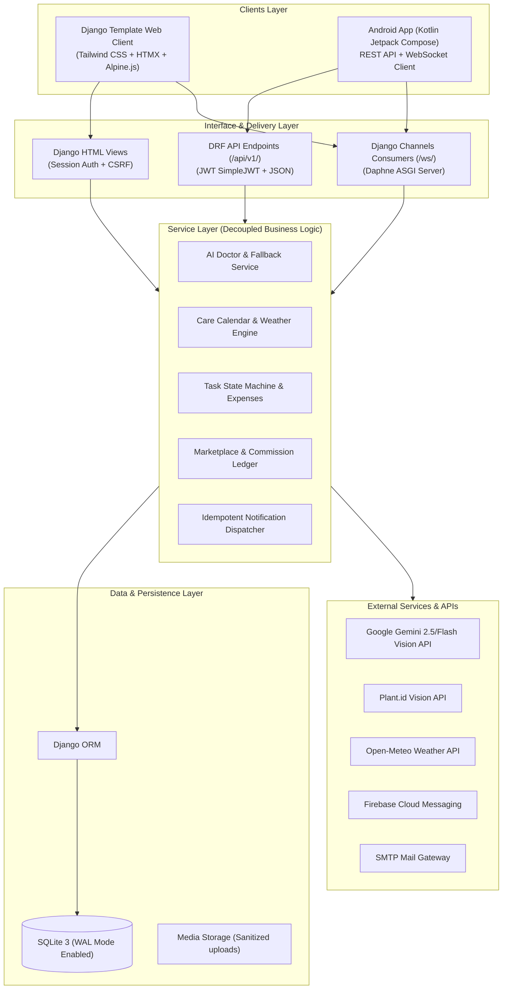

# Baghbaan AI — Technical Requirements Document (TRD)
**System Architecture & Technical Specifications**

---

## 1. System Architecture & Layered Design

Baghbaan AI utilizes a layered architectural pattern centered around a consolidated Django backend. This ensures that business logic is written once in pure Python services and reused seamlessly by both the HTML Django Template engine and the Django REST Framework (DRF) JSON API.



---

## 2. Technical Stack Specifications

| Component | Selected Technology | Version / Specification | Rationale |
|---|---|---|---|
| **Programming Language** | Python | 3.12+ (or 3.14.x) | Modern async syntax, performance enhancements, typing support |
| **Backend Framework** | Django | 6.0+ | Robust ORM, built-in admin, battle-tested security, i18n support |
| **REST API Engine** | Django REST Framework | 3.18+ | Standardized serialization, viewsets, throttling, permissions |
| **API Documentation** | drf-spectacular | 0.30+ | Automated OpenAPI 3.0 schema generation for Android client contract |
| **API Authentication** | SimpleJWT (`djangorestframework-simplejwt`) | 5.5+ | Stateless, secure short-lived access tokens (15m) + rotated refresh tokens |
| **Database** | SQLite 3 | WAL Mode (Write-Ahead Logging) | Zero-maintenance, single-file ACID compliance, high read concurrency |
| **Web Frontend** | Django Template Engine | Native Django DTL | Server-rendered SSR, zero client bundle weight, maximum SEO and speed |
| **Styling & Design** | Tailwind CSS 3 / CDN | RTL-enabled plugins | Utility-first responsive design, native Urdu RTL layout switching |
| **Interactivity** | HTMX & Alpine.js | 1.9+ / 3.x | Reactive UI components without bloated JavaScript SPA frameworks |
| **Real-time Engine** | Django Channels + Daphne | 4.3+ | ASGI WebSocket protocol handling for live multi-room chat |
| **Channel Layer** | In-Memory / Redis-ready | `InMemoryChannelLayer` | High-efficiency local FYP deployment, instant config swap to Redis |
| **AI Vision & NLP** | Google Gemini & Plant.id | Gemini 1.5/2.5 Flash API + Plant.id v3 | High-accuracy leaf diagnosis, Urdu context generation |
| **Weather Engine** | Open-Meteo REST API | v1 Forecast API | No API key required, reliable hourly precipitation and temperature data |

---

## 3. Database Configuration (SQLite WAL Mode)

To support concurrent read operations between web requests, REST API calls, background reminder workers, and WebSocket broadcasts, SQLite must run in **Write-Ahead Logging (WAL)** mode.

```python
# settings.py configuration for SQLite WAL Mode
DATABASES = {
    'default': {
        'ENGINE': 'django.db.backends.sqlite3',
        'NAME': BASE_DIR / 'db.sqlite3',
        'OPTIONS': {
            'timeout': 30,  # 30-second lock timeout
        }
    }
}

# Run on database connection initiation
# PRAGMA journal_mode=WAL;
# PRAGMA synchronous=NORMAL;
# PRAGMA busy_timeout=5000;
```

---

## 4. Decoupled Service-Layer Design

All core business operations reside exclusively in `services/` modules within respective apps:

### 4.1. AI Doctor Service (`ai_doctor.services`)
- **Image Validation:** Inspect file size ($\le 5\text{MB}$), MIME type (`image/jpeg`, `image/png`), and compute SHA-256 hash to prevent duplicate AI API queries.
- **Multimodal Pipeline:**
  1. *Step 1: Botanical Gatekeeper:* Prompt Gemini with a fast verification prompt: *"Does this image clearly show a plant, tree, crop, leaf, flower, or fruit? Return JSON {is_plant: bool, message: str}"*.
  2. *Step 2: Dual Identification:* Query Plant.id endpoint for plant taxonomy and disease probabilities.
  3. *Step 3: Cultural & Climate Context Treatment Generation:* Prompt Gemini to compose Urdu, Roman Urdu, and English treatments incorporating user's city (e.g. Lahore), current month/season, and organic home-kitchen remedies (e.g. Neem oil spray, wood ash, controlled pruning).
  4. *Step 4: Confidence Scoring:* Normalize probabilities. If aggregate confidence is $< 60\%$, flag as `uncertain` and trigger escalation suggestions.
  5. *Step 5: Fallback Handler:* If Plant.id returns HTTP 5xx or timeout, route directly to Gemini Vision standalone; if Gemini is unreachable, match symptoms against local `Disease` and `Treatment` knowledge base tables.

### 4.2. Care Calendar & Weather Engine (`care.services`)
- **Schedule Calculation:** Plants in the database define baseline watering frequency (days), fertilizing frequency (days), and pruning seasons.
- **Weather Adjustment Algorithm:**
  ```python
  def adjust_care_task_for_weather(user_plant, task_type, scheduled_date, city_lat, city_lng):
      """
      Fetches 24-48h forecast from Open-Meteo for the user's coordinates.
      - If rain >= 5.0 mm forecast within 24h: postpone outdoor watering by 24-48 hours.
      - If max temp >= 38 C: shorten watering interval by 1-2 days for heat-sensitive plants.
      - If min temp <= 3 C: emit frost warning note for sensitive varieties.
      """
  ```

### 4.3. Task State Machine (`services.services`)
- State transitions are strictly validated through a transition matrix:
  - Allowed: `CREATED -> ASSIGNED -> IN_PROGRESS -> SUBMITTED -> APPROVED`
  - Rejection loop: `SUBMITTED -> IN_PROGRESS` (with supervisor rejection comments)
  - Any out-of-order transition raises `InvalidTaskTransitionError`.

### 4.4. Marketplace & Commission Engine (`marketplace.services`)
- Product listing status lifecycle: `DRAFT -> PENDING_APPROVAL -> APPROVED / REJECTED`.
- Only approved products with `stock_quantity > 0` appear in the catalog.
- On order creation (`Order.objects.create`), the active `CommissionSetting` is fetched:
  $$\text{Commission Amount} = \text{Order Total} \times \left(\frac{\text{Commission Rate}}{100}\right)$$
- An immutable transaction record is logged in the `CommissionLedger`.

---

## 5. Real-Time Chat & Django Channels Architecture

- **Protocol:** WebSockets on `/ws/chat/<room_id>/`
- **Authentication Handshake:**
  - Web: Extracts Django session cookie from HTTP headers.
  - Mobile: Accepts query parameter `?token=<jwt_access_token>` and validates with `UntypedToken(token)`.
- **Authorization Matrix:**
  - `DIRECT`: Both users must share a valid `Order` or `GardenMember` link.
  - `GARDEN_TEAM`: `user.id in room.garden.members.values_list('user_id', flat=True)`.
  - `COMMUNITY`: Accessible to any active registered user.
- **Message Pipeline:**
  1. Consumer receives JSON packet `{ message: "...", image_id: optional }`.
  2. Message is sanitized and saved to `community_message` table.
  3. Message is broadcast via `channel_layer.group_send(room_group_name, payload)`.

---

## 6. Security & Defense in Depth

1. **Input Validation:** Strict Django Form and DRF Serializer validations on all incoming payloads.
2. **File Sanitization:** Uploaded images are re-encoded and saved with UUID filenames to prevent remote code execution or directory traversal.
3. **Throttling:**
   - Default user: 120 requests/minute.
   - AI endpoints: 10 diagnoses/hour per user to protect API quotas.
   - Login attempts: 5 failed attempts per 15 minutes before temporary lockout.
4. **Environment Variables:** API keys (`GEMINI_API_KEY`, `PLANT_ID_API_KEY`, `SECRET_KEY`) stored strictly in `.env` and loaded via `python-dotenv`.
